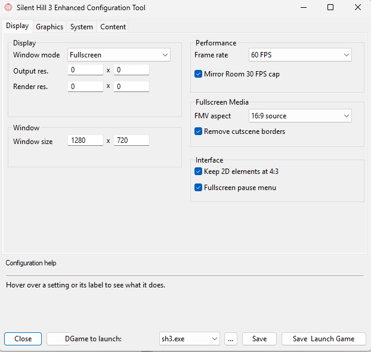
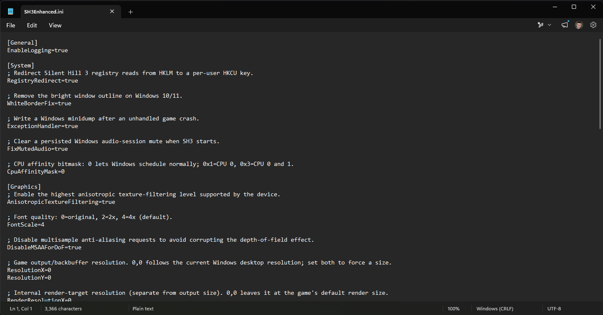

# SH3 Enhanced Configuration Tool

Use the Configuration Tool to edit `SH3Enhanced.ini` without changing the file by hand. Select a game executable, adjust settings across the Display, Graphics, System, and Content tabs, then save. **Save & Launch Game** saves the settings and starts the selected executable. Changes take effect after restarting the game.

You can also edit `SH3Enhanced.ini` directly in a text editor.

<table>
  <tr>
    <th>Configuration Tool</th>
    <th>Direct INI editing</th>
  </tr>
  <tr>
    <td></td>
    <td></td>
  </tr>
</table>

## Project layout

- `src/` contains the Win32 application source and dialog resources.
- `assets/` contains the application icon and Windows manifest.
- The Visual Studio project and solution files stay in the project root.

The configuration tool's UI was heavily inspired by the [Silent Hill 2: Enhanced Edition Launcher](https://github.com/elishacloud/Silent-Hill-2-Enhancements/tree/master/Launcher).

## Build

Open `SH3EnhancedConfigTool.slnx` in Visual Studio, select `Release | Win32`, and build the solution. The executable is written to `build/ConfigTool/Win32/Release/SH3Enhanced Config Tool.exe`.
